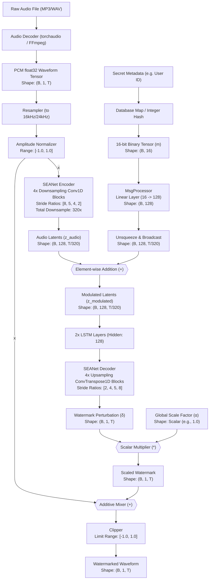
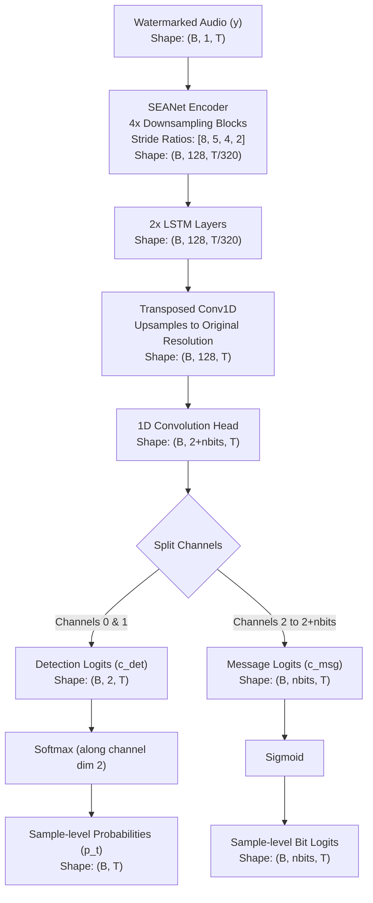

# AudioSeal: End-to-End Architectural Deep Dive
*Internal Systems Architecture and DSP Reference Document*

---

## 1. Executive Overview

**AudioSeal** is a state-of-the-art, deep-learning-based audio watermarking framework designed primarily for the **localized detection** of AI-generated speech and audio. 

Unlike traditional digital signal processing (DSP) watermarking systems, AudioSeal is built on a **jointly trained generator-detector neural network architecture** that operates directly in the **raw time domain**. It bypasses the hand-crafted heuristics of traditional systems by learning a non-linear, audio-dependent, additive perturbation that is psychoacoustically masked and highly robust to audio editing.

### Comparative Distinction
*   **AudioSeal vs. Audiowmark:** Audiowmark is a DSP-based framework utilizing a spectral **patchwork algorithm** in the Fourier (FFT) domain. It embeds data by pseudo-randomly modifying amplitude coefficients within specific frequency bins. AudioSeal, conversely, is ML-based, executing raw 1D temporal convolutions to directly predict time-domain waveforms, resulting in superior resistance to speed/pitch variations and localized cropping attacks.
*   **AudioSeal vs. WavMark:** WavMark is also deep-learning-based, but it operates in the **STFT (Short-Time Fourier Transform) domain**, utilizing Invertible Neural Networks (INN) to embed payload bits into the magnitude and phase of complex spectrograms. AudioSeal operates entirely in the time domain at inference, saving significant computational overhead by avoiding forward/inverse FFT computations.
*   **Key Attributes of AudioSeal:**
    *   **ML-Based:** Uses 1D convolutional neural networks (SEANet) and LSTMs.
    *   **Learned Spreading:** Replaces classical Direct Sequence Spread Spectrum (DSSS) pseudo-noise codes with a learned mapping from bit vectors to multi-scale waveform perturbations.
    *   **Time-Domain Processing:** No STFT/FFT is computed during inference.
    *   **Blind Extraction:** Does not require the original unwatermarked audio.
    *   **Sample-Level Localization:** Pinpoints watermark presence at a resolution of 1/16,000th of a second.

---

## 2. Complete Embedding Pipeline

The following diagram illustrates the complete, step-by-step tensor flow from the raw input audio to the final watermarked output.



---

## 3. Input Audio Representation

AudioSeal processes raw audio streams by decoding them into normalized, floating-point multi-channel tensors.

```text
song.mp3 / song.wav
      ↓
(Decoded via FFmpeg/torchaudio)
      ↓
PCM raw values
      ↓
(Divided by 2^15 for 16-bit PCM)
      ↓
float32 Tensor normalized to [-1.0, 1.0]
```

### Parameters
*   **Sample Rate:** AudioSeal models are strictly trained at a fixed sample rate, typically **16,000 Hz** (or **24,000 Hz** depending on the specific checkpoint). Input audio must be resampled to match this rate using high-quality sinc interpolation to prevent high-frequency aliasing.
*   **Channels:** AudioSeal is natively configured for single-channel (mono) inputs. Multi-channel audio (e.g., stereo) is downmixed using a simple mean calculation:
    $$x_{\text{mono}} = \frac{x_{\text{left}} + x_{\text{right}}}{2}$$
*   **Normalization:** Audio tensors must reside in the range $[-1.0, 1.0]$ before feedforward execution. Out-of-bounds amplitudes cause numerical saturation in early convolutional layers, leading to degraded watermarking quality.
*   **Batching & Tensor Shapes:**
    Input tensors follow the standard PyTorch audio format:
    $$\text{Shape: } (B, C, T)$$
    *   $B$: Batch size (e.g., $1$)
    *   $C$: Channels (strictly $1$)
    *   $T$: Number of samples ($16,000$ samples per second of audio).
    
    *Example:* A 30-second audio clip at 16 kHz corresponds to a tensor shape of `(1, 1, 480000)`.

---

## 4. Watermark Payload Generation

AudioSeal does not directly embed complex, high-level JSON metadata like `{"track_id": 501, "user_id": 10001}` into the audio. The payload capacity of the default pre-trained model is strictly limited to **16 bits**.

### Payload Translation Pathway
To store user and track identification, a database translation layer must map the complex metadata to a 16-bit integer ID, which is then converted to a binary tensor.

```text
JSON Metadata:
{ "track_id": 501, "user_id": 10001 }
      ↓
[Database Lookup Table / Hash Function]
      ↓
16-bit Integer ID (0 - 65,535)
Example: 42069
      ↓
[Integer to Binary Representation]
      ↓
Binary Vector: [1, 0, 1, 0, 0, 1, 0, 0, 0, 1, 0, 1, 0, 1, 0, 1]
      ↓
PyTorch Float Tensor
Shape: (B, 16)
```

### Limitations
*   **Capacity:** 16 bits allow for exactly $2^{16} = 65,536$ unique combinations.
*   **Representation:** The payload is processed as a binary sequence ($m \in \{0, 1\}^{16}$) represented in float32. There are no tokens or learned semantic embeddings in this payload; it is a raw bit-vector projection.

---

## 5. AudioSeal Generator Architecture

The AudioSeal Generator is based on the **SEANet** (Speech Enhancement Network) architecture—an encoder-decoder network featuring 1D temporal convolutions, dilated residual blocks, and a recurrent bottleneck.

### 1D Convolutional Encoder
The encoder downsamples the audio along the temporal axis to extract hierarchical audio features. It consists of an initial 1D convolution followed by four downsampling blocks.

*   **Initial Layer:** `Conv1d` (Kernel Size: 7, Stride: 1, Padding: 3). Maps input channels ($C=1$) to base filter count ($N_f=32$).
    *   *Input Shape:* `(B, 1, T)`
    *   *Output Shape:* `(B, 32, T)`
*   **Downsampling Strides (Ratios):** `[8, 5, 4, 2]`
    *   *Total Downsampling Factor:* $8 \times 5 \times 4 \times 2 = 320$.
    *   *Latent Sequence Length:* $T' = T / 320$ (e.g., $16,000 \text{ Hz} \to 50 \text{ Hz}$ frame rate).
*   **Internal Block Layers:**
    Each downsampling block $i$ (with ratio $r_i$) contains:
    1.  **Dilated Residual Unit:** Captures local temporal context without shrinking resolution.
        *   `ELU` Activation ($\alpha=1.0$).
        *   `Conv1d` (Kernel: 3, Padding: 1).
        *   `ELU` $\to$ `Conv1d` (Kernel: 3, Dilation: 1, 3, or 9 depending on layer).
        *   *Skip Connection:* Input is added directly to output (`true_skip = true`).
    2.  **Downsampling Conv1D:** Shrinks the sequence length.
        *   `ELU` $\to$ `Conv1d` (Kernel Size: $2 \times r_i$, Stride: $r_i$, Padding: $r_i / 2$).
*   **Layer Dimensional Progression (for $N_f=32$, $D=128$):**
    *   *Encoder Input:* `(B, 1, T)`
    *   *Post-Conv1D:* `(B, 32, T)`
    *   *Block 1 (Stride 8):* `(B, 64, T/8)`
    *   *Block 2 (Stride 5):* `(B, 128, T/40)`
    *   *Block 3 (Stride 4):* `(B, 128, T/160)`
    *   *Block 4 (Stride 2):* `(B, 128, T/320)`

### Bottleneck and Message Insertion
The bottleneck uses recurrent layers to process the downsampled sequence and integrates the message payload.
*   **LSTM Layers:** 2 layers of Bi-directional LSTM with hidden dimension size $128$.
*   **MsgProcessor:** Contains a linear layer $W \in \mathbb{R}^{128 \times 16}$.
    *   *Input Message ($m$):* `(B, 16)`
    *   *Projection ($e_{msg}$):* $e_{msg} = W \cdot m$ with shape `(B, 128)`.
*   **Mixing:** The message embedding is broadcasted along the time axis $T'$ and added:
    $$z_{modulated} = z_{audio} + e_{msg}.\text{unsqueeze}(-1)$$
    *   *Shape:* `(B, 128, T/320) + (B, 128, 1) -> (B, 128, T/320)`

### Decoder (Upsampling Path)
The decoder mirrors the encoder, mapping the modulated latent tensor back to the original audio shape.
*   **Upsampling Strides:** Reversed sequence `[2, 4, 5, 8]`.
*   **Upsampling Layer:** `ConvTranspose1d` (Kernel: $2 \times r_j$, Stride: $r_j$, Padding: $r_j/2$).
*   **Final Output Layer:** `Conv1d` (Kernel: 7, Stride: 1, Padding: 3). Maps channels back to $1$.
*   *Output Shape:* `(B, 1, T)` (Watermark perturbation waveform $\delta$).

---

## 6. Watermark Signal Creation

The output of the generator's decoder is a raw, time-domain waveform perturbation $\delta(t)$ matching the shape of the original audio.

$$\text{Original Audio: } x(t)$$
$$\text{Watermark Signal: } \delta(t)$$
$$\text{Watermarked Audio: } y(t) = x(t) + \alpha \cdot \delta(t)$$

```text
Original Audio: x(t) ────> [ + ] ────> [ Clip ] ────> Watermarked Audio: y(t)
                            ▲
                            │
Watermark: δ(t) ────> [ x α ]
```

### Properties
*   **Additive & Content-Dependent:** The watermark signal $\delta(t)$ is directly added to the waveform. It is a non-linear, input-dependent perturbation. The generator learns to shape $\delta(t)$ according to the spectral envelope of $x(t)$, placing energy in regions with high psychoacoustic masking (e.g., transient phases and noisy spectral frames) where human hearing sensitivity is low.
*   **Waveform Modification:** Because the modification is additive in the time domain, no phase reconstruction or STFT conversion is required.

---

## 7. Spread Spectrum Analysis

AudioSeal does not use traditional digital spread spectrum techniques like Direct Sequence Spread Spectrum (DSSS) or Code Division Multiple Access (CDMA), which rely on multiplying signals with fixed pseudo-random noise (PRN) codes.

Instead, AudioSeal implements **Learned Spreading**:

```text
Traditional DSSS:
Message Bit ────> [ XOR ] ────> [ Pseudo-Noise (PN) Code ] ────> Spread Signal
                    ▲
                    │
               Clock (Chip)

AudioSeal Learned Spreading:
Message Bit (16-dim) ────> [ Linear Layer ] ────> [ SEANet Decoder (CNN) ] ────> Watermark Signal δ (T-dim)
```

The network maps the static 16-bit message vector into a 128-dimensional latent space. The CNN decoder then expands this representation into a complex, spread waveform perturbation $\delta(t)$ of length $T$. The spreading code is learned end-to-end to maximize detector accuracy while satisfying perceptual constraints.

### Head-to-Head Architectural Comparison

| Feature | AudioSeal | Audiowmark |
| :--- | :--- | :--- |
| **Spreading Mechanism** | **Learned Spreading** via deep neural network projection and convolution. | **DSSS / Patchwork** using a pseudo-random block pattern generator. |
| **Domain** | **Time-Domain (1D Waveform)**. Convolutions operate directly on raw samples. | **Frequency-Domain (FFT)**. Modification is applied to Fourier coefficients. |
| **Frequency Bands** | **Adaptive / Learned**. The model distributes energy across the spectrum dynamically. | **Explicit**. Watermark is restricted to bands (typically 1 kHz to 3 kHz). |
| **Neural Network** | **Yes** (SEANet Encoder/Decoder + LSTM Bottleneck). | **No** (Pure classical DSP heuristics). |
| **Synchronization** | **Not Required**. Blind, sample-level localization is built into the architecture. | **Required**. Relies on sliding correlation to locate block boundaries. |

---

## 8. Frequency Domain Analysis

The AudioSeal generator and detector operate entirely in the time domain during inference. Neither network computes an **FFT, STFT, or Mel Spectrogram** when processing audio.

### Codec Robustness without Spectral Processing
Because lossy audio compression (such as MP3, AAC, and Opus) removes high-frequency spectral components and modifies sub-band phases, time-domain watermarks are vulnerable unless designed carefully. AudioSeal survives compression through its training objective:
1.  **Differentiable Codec Simulation:** During training, a differentiable codec simulator (or approximation layer) is placed between the generator and detector.
2.  **Multi-Scale Spectral Loss:** The training loss computes STFTs at multiple window sizes (e.g., 512, 1024, 2048) to minimize spectral distortion:
    $$\mathcal{L}_{\text{spec}}(x, y) = \sum_{s} \left( \| |STFT_s(x)| - |STFT_s(y)| \|_1 + \| \log |STFT_s(x)| - \log |STFT_s(y)| \|_1 \right)$$
3.  **Learned Resistance:** This optimization forces the generator to structure the time-domain perturbation $\delta(t)$ so that its message content is carried in the low-to-mid frequency components and phase structures that audio codecs preserve.

---

## 9. Watermark Injection Mathematics

The injection of the watermark perturbation into the host audio is governed by the following formulation:

$$y = \text{clip}\left( x + \alpha \cdot \text{tanh}(\delta), -1.0, 1.0 \right)$$

### Variables
*   $x$: Raw input audio tensor of shape `(B, 1, T)`.
*   $\delta$: Watermark perturbation output from the decoder of shape `(B, 1, T)`.
*   $\text{tanh}(\delta)$: Activation function bounding the perturbation range to $[-1.0, 1.0]$.
*   $\alpha$: Global scaling scalar that adjusts the watermark's amplitude. Lower values (e.g., $0.1$) prioritize imperceptibility, while higher values (e.g., $1.5$) increase detection robustness.
*   $y$: Output watermarked audio tensor of shape `(B, 1, T)`.
*   $\text{clip}(u, -1.0, 1.0)$: Clamping function that limits values to the dynamic range of float32 PCM, preventing digital clipping distortion.

---

## 10. Detector Architecture

The AudioSeal Detector is a single-pass model designed to perform localized, sample-level watermark detection and message decoding.



### Layer Dimensions
1.  **Detector Encoder:** Mirrored SEANet structure. Maps `(B, 1, T) -> (B, 128, T/320)`.
2.  **LSTM Layers:** Processes temporal context over downsampled steps. Shape: `(B, 128, T/320)`.
3.  **Upsampling Layer:** `ConvTranspose1d` upsamples the sequence length back to the original resolution $T$. Shape: `(B, 128, T)`.
4.  **Classification Head:** `Conv1d` with kernel size 1. Maps $128 \to 2 + N_{bits}$ output channels. Shape: `(B, 2 + 16, T)`.

---

## 11. Detection Mathematics

The detector head outputs a logit tensor $l \in \mathbb{R}^{B \times (2 + N_{bits}) \times T}$. At each time step $t \in [1, T]$, the system extracts two classes of outputs:

### 1. Watermark Presence Detection
The first two channels contain the logits for watermark absence ($l_{det, t}[0]$) and watermark presence ($l_{det, t}[1]$):

$$p_t = \text{Softmax}(l_{det, t})[1] = \frac{e^{l_{det, t}[1]}}{e^{l_{det, t}[0]} + e^{l_{det, t}[1]}}$$

*   $p_t \in [0.0, 1.0]$ represents the probability that sample $t$ is watermarked.
*   **Localization:** If $p_t > \tau$ (where $\tau$ is the detection threshold, default $0.5$), sample $t$ is classified as watermarked.
*   **Global Score:** The overall detection score $P$ for the entire audio clip is the temporal mean of the sample probabilities:
    $$P = \frac{1}{T} \sum_{t=1}^T p_t$$
    If $P > 0.5$, the audio is determined to contain the watermark.

---

## 12. Message Decoding

The remaining $N_{bits}$ channels (index $2$ to $2 + N_{bits}$) represent the message bits.

```text
Message Logits at sample t: [ l_msg,t,1, l_msg,t,2, ..., l_msg,t,nbits ]
                                 ↓
                         [ Sigmoid Function ]
                                 ↓
Bit Probabilities at sample t: [ q_t,1, q_t,2, ..., q_t,nbits ]
```

### Formulation
For each bit index $i \in [1, N_{bits}]$ at sample $t$, the probability that the bit is $1$ is given by:

$$q_{t, i} = \text{Sigmoid}(l_{msg, t, i}) = \frac{1}{1 + e^{-l_{msg, t, i}}}$$

Because the message payload is uniform across the watermark, these probabilities are aggregated over time. To avoid noise from unwatermarked regions, the aggregation is restricted to frames where the watermark is detected ($p_t > 0.5$):

$$\bar{q}_i = \frac{\sum_{t: p_t > 0.5} q_{t, i}}{\sum_{t: p_t > 0.5} 1}$$

The final decoded message bit $m_i \in \{0, 1\}$ is determined by thresholding the aggregated probability:

$$m_i = \begin{cases} 1 & \text{if } \bar{q}_i > 0.5 \\ 0 & \text{otherwise} \end{cases}$$

### Error Tolerances and Lookup
In production, if the extracted payload $m = [m_1, m_2, ..., m_{16}]$ does not exactly match a registered database key due to transmission noise, the system computes the **Hamming Distance** against all active keys in the database:

$$D_H(m, K_k) = \sum_{i=1}^{16} (m_i \oplus K_{k, i})$$

The metadata associated with the key that minimizes $D_H$ is returned, provided it falls within a maximum allowable bit error threshold (e.g., $D_H \le 2$).

---

## 13. Robustness Training

AudioSeal models are optimized using an encoder-attack-detector pipeline. The model learns to generate watermarks that remain detectable after passing through a variety of simulated distortions.

```text
               ┌──────────────────────────────┐
               │    Original Audio wave: x    │
               └──────────────┬───────────────┘
                              │
                              ▼
               ┌──────────────────────────────┐
  Message: m ──>      Generator Model         │
               └──────────────┬───────────────┘
                              │ Watermark: δ
                              ▼
               ┌──────────────────────────────┐
               │    Additive Mixer: x + δ     │
               └──────────────┬───────────────┘
                              │
                              ▼
               ┌──────────────────────────────┐
               │   Differentiable Attacks     │  <-- (Codec, Noise, Filtering,
               │         Module: A            │       Time-Stretch, Pitch-Shift)
               └──────────────┬───────────────┘
                              │ Attacked Audio: y_attack
                              ▼
               ┌──────────────────────────────┐
               │       Detector Model         │
               └──────┬──────────────┬────────┘
                      │              │
                      ▼              ▼
               [ Det Loss ]    [ Msg Loss ]
```

### Core Losses
*   **Detector Loss ($\mathcal{L}_{\text{det}}$):** Binary Cross Entropy (BCE) comparing predicted sample probabilities $p_t$ with the ground-truth mask.
*   **Message Loss ($\mathcal{L}_{\text{msg}}$):** BCE loss evaluating decoded bit probabilities against the input message $m$.
*   **Perceptual Losses:**
    *   **$\ell_1$ Waveform Loss:** Restricts the watermark's amplitude.
    *   **Multi-Scale Spectral Loss:** Minimizes changes to the audio's spectral envelope.
    *   **Adversarial Loss (GAN):** Uses a discriminator network to ensure watermarked and unwatermarked audio remain indistinguishable.

### Training Loop Pseudocode
```python
for epoch in epochs:
    for batch_audio, batch_msg in dataloader:
        # 1. Generate watermark
        watermark = generator(batch_audio, batch_msg)
        watermarked_audio = batch_audio + watermark
        
        # 2. Apply random differentiable attacks
        attacked_audio = apply_attacks(
            watermarked_audio, 
            mp3_simulation=True, 
            noise_db=random.uniform(10, 30), 
            crop_ratio=random.uniform(0.5, 1.0),
            resample_rate=random.choice([8000, 11025, 22050, 44100])
        )
        
        # 3. Detector prediction
        p_det, p_msg = detector(attacked_audio)
        
        # 4. Compute losses
        loss_det = bce_loss(p_det, ground_truth_mask)
        loss_msg = bce_loss(p_msg, batch_msg)
        loss_perceptual = spectral_loss(batch_audio, watermarked_audio) + l1_loss(watermark)
        
        total_loss = loss_det + loss_msg + loss_perceptual
        
        # 5. Optimize
        optimizer.zero_grad()
        total_loss.backward()
        optimizer.step()
```

---

## 14. Why AudioSeal Survives Attacks

| Attack | Why it survives |
| :--- | :--- |
| **MP3 / AAC Compression** | The generator is optimized against a multi-scale spectral reconstruction loss and a differentiable codec simulator during training, forcing it to embed information in the low-to-mid frequency structures that lossy codecs preserve. |
| **Cropping** | The detector evaluates audio at the sample level and does not rely on global synchronization markers. If any fragment of the watermarked audio survives, the detector can identify and decode the watermark from that segment. |
| **Telegram Compression** | Survives via training exposure to aggressive downsampling (to 8 kHz/12 kHz) and low-bitrate OPUS/AAC compression simulations. |
| **Additive Noise** | During training, random Gaussian, pink, and environmental noise are added to the signal, forcing the detector to learn noise-resilient features. |
| **Reverb** | Survives due to the inclusion of Room Impulse Response (RIR) convolutions during training, which models acoustic reflections and echo patterns. |

---

## 15. Computational Cost

AudioSeal's feedforward 1D convolutional architecture makes it highly efficient compared to iterative, search-based DSP watermarking algorithms.

### Benchmark Resource Estimates (per 1 minute of mono audio)

*   **Embedding (Generator):**
    *   **CPU (Intel Xeon 4-core):** ~45 ms latency, peak RAM ~120 MB.
    *   **GPU (NVIDIA T4):** ~4 ms latency, peak VRAM ~180 MB.
*   **Detection (Detector):**
    *   **CPU (Intel Xeon 4-core):** ~35 ms latency, peak RAM ~90 MB.
    *   **GPU (NVIDIA T4):** ~3 ms latency, peak VRAM ~150 MB.

### Complexity
Unlike DSP algorithms where synchronization search times scale non-linearly with audio length, AudioSeal's detection complexity is strictly linear:
$$\mathcal{O}(T)$$
This predictable scaling makes it well-suited for high-throughput production environments.

---

## 16. Production Architecture

The diagram below shows how AudioSeal would integrate into a music leak attribution pipeline.

```text
┌─────────────────┐      1. User ID & Track ID      ┌──────────────────────┐
│  Download Request ├───────────────────────────────>│  App Server          │
└─────────────────┘                                 └──────────┬───────────┘
                                                               │
                                                               │ 2. Query
                                                               ▼
┌─────────────────┐      3. Unique 16-bit ID        ┌──────────────────────┐
│  Postgres DB    │<────────────────────────────────┤  Metadata Database   │
│  (Client Map)   ├────────────────────────────────>│  (Mapping Table)     │
└─────────────────┘                                 └──────────┬───────────┘
                                                               │
                                                               │ 4. 16-bit Payload + Audio
                                                               ▼
┌─────────────────┐      6. Send Watermarked Audio  ┌──────────────────────┐
│  End User       │<────────────────────────────────┤  Watermarking Worker │
└─────────────────┘                                 │  (AudioSeal Service) │
                                                    └──────────────────────┘
```

### Integration Points
1.  **Metadata Mapping:** The application server maps the transaction metadata to a unique 16-bit ID ($0 - 65,535$).
2.  **Worker Nodes:** The audio file and the 16-bit ID are dispatched to a worker node (e.g., running on AWS ECS or AWS Lambda).
3.  **Watermarking:** The worker loads the raw audio, resamples it, converts the ID to a binary tensor, runs the AudioSeal generator, and writes the output.
4.  **Delivery:** The watermarked file is returned to the user.

---

## 17. AudioSeal vs. Audiowmark

| Dimension | AudioSeal | Audiowmark |
| :--- | :--- | :--- |
| **Architecture** | **ML-Based** (SEANet 1D CNN + LSTM). | **DSP-Based** (Patchwork algorithm in the FFT domain). |
| **Explainability** | **Low**. The watermark pattern is a learned neural network output and cannot be modeled analytically. | **High**. Operates on mathematical alterations to specific frequency coefficients. |
| **Legal Defensibility** | **Moderate**. Subject to potential false positives on out-of-distribution audio, which can complicate legal challenges. | **High**. The algorithm is deterministic and verifiable via open-source DSP math. |
| **AWS Deployment Cost** | **High**. Requires GPU nodes (e.g., AWS ECS `g4dn` instances) for high-throughput batching. | **Low**. Highly optimized C++ executable that runs on low-cost CPU instances. |
| **Throughput Latency** | **Extremely Fast** (Single-pass GPU execution takes milliseconds). | **Moderate** (CPU execution scales with block synchronization search time). |
| **Payload Capacity** | **Low** (Strictly limited to 16 bits in default models). | **High** (Supports 128 bits, allowing native UUID storage). |
| **Robustness (Pitch/Speed)** | **Excellent**. Resilient to time-stretching and pitch-shifting attacks. | **Poor**. Speed or pitch changes desynchronize the FFT blocks. |
| **Robustness (Compression)** | **High** (Resilient down to low bitrates). | **Excellent** (Resilient to standard MP3/AAC compression). |

---

## 18. Recommendation

For a music leak attribution platform tracking user downloads and tracks, the recommended approach is to deploy **Audiowmark** rather than AudioSeal.

### Justification
1.  **Payload Constraints:**
    A music leak attribution platform requires identifying both the track and the downloading user. Combining a `track_id` and `user_id` into a 16-bit space ($0 - 65,535$) is impractical. It introduces database collision risks and prevents embedding robust, independent identifiers. Audiowmark’s 128-bit payload capacity easily accommodates a 64-bit user UUID and a 64-bit track ID.
2.  **Legal Defensibility:**
    Leak attribution can lead to legal action against individuals. A DSP-based watermarking algorithm like Audiowmark relies on deterministic Fourier coefficient changes, making its detection metrics transparent and defensible in court. Neural networks, by contrast, can suffer from unpredictable edge-case behavior and out-of-distribution drift.
3.  **Operational Cost:**
    Audiowmark is a highly optimized C++ codebase that runs efficiently on standard CPU instances. Deploying AudioSeal at scale requires GPU-enabled infrastructure to support real-time generation during high-volume downloads, increasing operational costs.
4.  **Summary:**
    While AudioSeal is highly robust against cropping and speed-shifting, its payload limitations and operational requirements make it less suitable for this use case. **Audiowmark** remains the more practical choice for this production pipeline.
